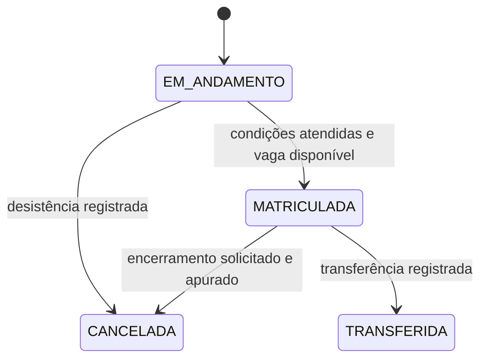

# MD-00 — Regras e exemplos para validação

> Entrega documental de 08/10/2026. Estado: **Em validação**. Sem aplicação, contrato emitido ou uso de dados reais. Registro de trabalho: [TASK-0002](../../tasks/TASK-0002-md00-regras-e-exemplos.md).

## Como revisar

1. Conferir o [plano financeiro](financeiro.md), sobretudo ingresso tardio e descontos.
2. Percorrer os [cenários de aceite](cenarios.md), verificando o resultado esperado.
3. Revisar os [esboços de telas](telas.md) como roteiro de atendimento.
4. Indicar ajustes pelos identificadores C-01, P-01 etc. O aceite de uma regra não encerra automaticamente as pendências externas ou a entrega inteira.

## Autoridade das regras

**Confirmado:** decisões do usuário e adequações legais incorporadas na [especificação](../../SPECIFICATION.md). Em 08/10/2026 o usuário confirmou ingresso tardio com meses restantes mais parcela inicial. Esta regra comercial integra o total contratado do período; não há parcela inicial externa a esse total.

**Proposto para validação:** nomes de estados, disposição das telas e tratamento de detalhes ainda não decididos, identificados abaixo. Não são exigências legais presumidas.

**Pendente externo:** contrato/lista reais, atos da escola e enquadramentos que ainda não foram inspecionados. O [mapa normativo](../../compliance.md) mantém as fontes. Este material não valida cobrança real ou substitui o contrato.

## Fluxo de atendimento

1. Secretaria encontra ou cadastra aluno, filiação, representantes e contratante financeiro.
2. Seleciona ano, etapa, turma e campanha aplicáveis, conferindo requisitos da etapa e condições contratuais.
3. Salva matrícula em andamento e plano financeiro; não ocupa vaga. Registra a obrigação inicial uma única vez.
4. Registra recebimento inicial ou autorização formal de negociação/dispensa pelo Diretor. Pagamento parcial sem acordo não satisfaz sozinho a condição de confirmação.
5. Confere disponibilidade atual e elegibilidade; confirma matrícula, ocupa vaga, gera parcelas restantes e registra auditoria na mesma transação. Pagamento prévio não reserva vaga: se não houver capacidade, manter pendência e tratar devolução ou alternativa com o contratante, sem impor outra turma.
6. Acompanha documentos necessários e conclusão administrativa separadamente de livros, vendas e finanças.
7. Registra pagamentos, ajustes e solicitações de encerramento com histórico; dívida não impede direitos escolares.

## Estados independentes

Os rótulos abaixo são modelo conceitual para validação, não enumeração de banco já implementada.

| Dimensão | Estados propostos | Significado |
| --- | --- | --- |
| Matrícula | EM_ANDAMENTO, MATRICULADA, CANCELADA, TRANSFERIDA | Só MATRICULADA ocupa vaga; encerramento tem data, motivo e autor |
| Conclusão administrativa | PENDENTE, COMPLETA | Documentos legitimamente exigíveis conferidos ou exceção fundamentada; não significa quitação |
| Parcela inicial | ABERTA, PARCIAL, QUITADA, NEGOCIADA, DISPENSADA | Situação derivada de valores e acordo; NEGOCIADA só permite confirmar quando cumprida a condição autorizada |
| Cobrança | ABERTA, PARCIAL, QUITADA, CANCELADA | Atraso é calculado pela data, saldo exigível e situação; pode existir em cobrança parcial |
| Restituição | A_APURAR, APROVADA, REALIZADA | Crédito reconhecido não significa dinheiro já devolvido |

Pagamento revertido, perda de desconto ou débito posterior não transformam automaticamente MATRICULADA em EM_ANDAMENTO/CANCELADA. Conclusão administrativa de matrícula encerrada permanece como histórico, sem reabrir pendências para cobrar documentos desnecessários.

Solicitar documentos de transferência não encerra automaticamente o vínculo: a data efetiva de saída deve ser registrada conforme o pedido. Transferência não exige quitação ou assinatura de ciência. Reativação de vínculo encerrado e troca de turma não foram definidas nesta MD-00; não presumir transição automática.

## Pessoas e permissões

Aluno é a pessoa atendida. Filiação é dado familiar; representante legal tem poderes demonstrados; contratante assume obrigações financeiras. A mesma pessoa pode acumular papéis, mas um papel não concede os demais. Autorização de retirada é específica. Identificar possível benefício de irmãos não transfere dívida nem comprova parentesco por si só.

Secretaria opera cadastros, recebimentos e documentos; Diretor aprova negociações e decisões financeiras excepcionais; TI cuida da operação técnica com acesso limitado. A matriz detalhada de permissões será validada na MD-02; documentos judiciais/de saúde não ficam disponíveis a todos por padrão.

## Documentos: lista de trabalho, não exigência universal

| Finalidade | Informação/evidência a avaliar | Condição de uso |
| --- | --- | --- |
| Identificar aluno | Identidade e nascimento; documento civil quando necessário | Definir o que precisa ser conferido e se cópia é indispensável |
| Identificar contratante | Identificação suficiente para contrato e procedimento fiscal | Não coletar campos extras sem finalidade |
| Verificar representação | Vínculo de filiação, guarda/tutela ou instrumento pertinente | Solicitar somente a evidência adequada ao caso; não presumir que pagador representa |
| Registrar contratação | Versão aceita, partes, plano e evidência de aceite/assinatura | Modalidade e validade da assinatura ainda serão definidas |
| Vida escolar | Documentação pertinente à etapa e à transferência | Confirmar norma aplicável e tratar ausência conforme procedimento legítimo |
| Apoio à inclusão | Informação estritamente necessária para atendimento | Sem laudo universal obrigatório, sobretaxa ou recusa automática |

Cada item futuro da lista deve indicar etapa, finalidade/fundamento, exigibilidade, responsável por conferência, acesso e retenção. Consentimento opcional de imagem, aquisição de livros, uniforme e entrega de material coletivo não são documentos obrigatórios de conclusão.

## Pendências delimitadas

| ID | Questão | Limite enquanto pendente |
| --- | --- | --- |
| P-01 | Conferir contrato, lista de materiais, ficha e valores das outras etapas | Não emitir contrato/cobrança real nem extrapolar valores do Infantil |
| P-02 | Confirmar autorização, capacidade, idades e documentos exigíveis por etapa | Não declarar escola/turma habilitada para oferta real sem evidência |
| P-03 | Definir desconto de pontualidade em pagamento parcial e crédito, data efetiva, feriado/fim de semana e arredondamento | Totais pontuais pressupõem liquidação integral no prazo, sem simular calendário bancário; casos parciais usam dívida já vencida, sem desconto condicional |
| P-04 | Definir ingresso após o dia 10 e eventual negociação/proporção diária do primeiro mês | Exemplo tardio usa ingresso no dia 1º e mês completo; o usuário confirmou proporção por quantidade de meses, não por dias |
| P-05 | Política após início das aulas: mês de saída, valores devidos e restituição da parcela inicial | Não presumir retenção integral, restituição integral ou multa; apurar e revisar contrato antes de lançar valor final |
| P-06 | Forma de aceite contratual, evidências de representação e quem autoriza/efetiva restituição | Fluxo proposto separa aprovação e registro da devolução; validar permissões e procedimento |
| P-07 | Bases legais, retenção, canais, contratos de fornecedores e procedimento fiscal | Não usar dados reais em testes; concluir antes das operações reais afetadas |

Pendências não impedem a revisão documental nem a preparação técnica independente posteriormente autorizada. A MD-01 não é iniciada por esta entrega.
